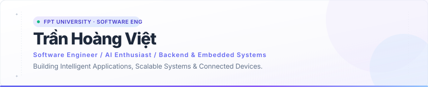
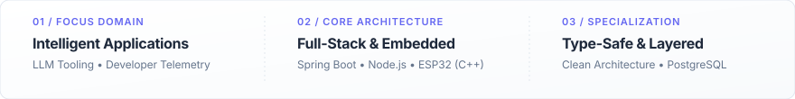

  

  
  &nbsp;&nbsp;
  

 

### About

I am a Software Engineering student at FPT University focused on building reliable backends, exploring modern AI architectures, and integrating hardware with distributed systems. I prioritize clean engineering, maintainable codebases, and shipping real-world applications.

- **Intelligent Applications & AI** — Exploring Large Language Model workflows, agent architectures, and automated engineering analytics.
- **Backend & Systems Architecture** — Designing layered RESTful APIs, high-concurrency services, and clean relational schemas with Spring Boot and Node.js.
- **IoT & Embedded Systems** — Developing firmware, sensor telemetry pipelines, and device-to-cloud integrations using ESP32, Arduino, and MQTT.

 

### Stack

#### Languages & Core

  &nbsp;&nbsp;&nbsp;
  &nbsp;&nbsp;&nbsp;
  &nbsp;&nbsp;&nbsp;
  &nbsp;&nbsp;&nbsp;
  

#### Frontend & Mobile

  &nbsp;&nbsp;&nbsp;
  &nbsp;&nbsp;&nbsp;
  &nbsp;&nbsp;&nbsp;
  

#### Backend & Databases

  &nbsp;&nbsp;&nbsp;
  &nbsp;&nbsp;&nbsp;
  &nbsp;&nbsp;&nbsp;
  &nbsp;&nbsp;&nbsp;
  &nbsp;&nbsp;&nbsp;
  

#### AI & Embedded Systems

  &nbsp;&nbsp;&nbsp;
  &nbsp;&nbsp;&nbsp;
  &nbsp;&nbsp;&nbsp;
  

#### Tools & Environments

  &nbsp;&nbsp;&nbsp;
  &nbsp;&nbsp;&nbsp;
  &nbsp;&nbsp;&nbsp;
  &nbsp;&nbsp;&nbsp;
  

 

### Featured Projects

---

#### 01 / Flow Intelligence for GitHub

> AI-driven developer telemetry and engineering analytics platform that transforms GitHub event streams into predictive delivery insights and automated executive summaries.

- **Predictive PR Delivery:** Machine learning regression models forecasting pull request merge latency to mitigate delivery risks early.
- **Evidence Cards & Risk Rulebook:** Automated detection engine uncovering review bottlenecks, stale checks, and abnormal branch churn.
- **AI Executive Briefs:** Periodic telemetry summaries synthesized by Google Gemini with deterministic fallback and trend analysis.

**Architecture & Stack:** `React 19` · `TypeScript` · `Node.js / Express 5` · `MongoDB` · `Google Gemini AI` · `GitHub OAuth & Webhooks` · `Vitest`

&rarr; [Explore Repository (diethon/Flow-Intelligence-Github)](https://github.com/diethon/Flow-Intelligence-Github)

---

#### 02 / HESTA Smart Home Ecosystem

> Comprehensive hardware-to-cloud smart living solution developed as an Engineering Capstone (SEP490) at FPT University, uniting real-time embedded firmware with multi-tier enterprise services.

- **Embedded Firmware & Telemetry:** C++ firmware running on ESP32 microcontrollers managing environmental sensors and actuator relays over local network protocols.
- **Layered Enterprise Backend:** Multi-tier architectural pattern implemented in Java and Spring Boot, persisting to PostgreSQL with secure token authentication.
- **Multi-Platform Management:** Responsive React & TypeScript web administration dashboard alongside cross-platform Flutter mobile applications.

**Architecture & Stack:** `ESP32 / C++` · `Java / Spring Boot` · `PostgreSQL` · `React` · `TypeScript` · `Flutter` · `RESTful API`

&rarr; [Firmware & IoT Repository](https://github.com/diethon/iot_hesta) · [Backend API Repository](https://github.com/diethon/backend_hesta) · [Frontend Dashboard Repository](https://github.com/diethon/frontend_hesta)

---

#### 03 / Reminder Web App

> Distraction-free, responsive task scheduling and reminder web application engineered for rapid daily task management and productivity.

- **Frictionless Task Capture:** Clean interface optimized for rapid task entry, localized temporal reminders, and priority sorting.
- **Optimized Client Performance:** Component architecture compiled with Vite and React for instant hot updates and zero layout shifts.
- **Type-Safe Contract:** Strict TypeScript interfaces guaranteeing schema reliability across client state and browser persistence.

**Architecture & Stack:** `React` · `TypeScript` · `Vite` · `Tailwind CSS` · `Local Storage`

&rarr; [Explore Repository (diethon/reminder-web)](https://github.com/diethon/reminder-web)

 

### Engineering Metrics & Focus

  

 

### Let's Connect

*"Let's build something meaningful together."*

  
  &nbsp;&nbsp;
  

  

